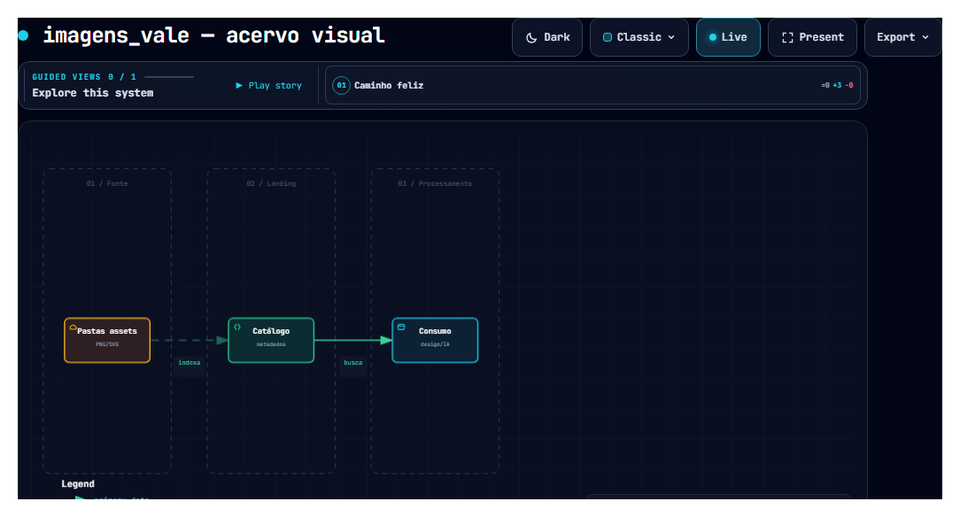

# imagens_vale — acervo visual

imagens_vale — acervo visual.

## Arquitetura

> PNG Archify para Overview do Azure DevOps. Fluxo animado: [docs/02-arquitetura.md](docs/02-arquitetura.md).

## Documentação

| Documento | Conteúdo |
|-----------|----------|
| [docs/README.md](docs/README.md) | Índice |
| [docs/00-enquadramento.md](docs/00-enquadramento.md) | Lite/full |
| [docs/02-arquitetura.md](docs/02-arquitetura.md) | Archify + zonas |
| [docs/14-dor-dod.md](docs/14-dor-dod.md) | DoR/DoD |
| [docs/15-git-pr.md](docs/15-git-pr.md) | Git/PR |

## Azure DevOps

https://dev.azure.com/vale-devops/torre-mobilidade/_git/imagens_vale
