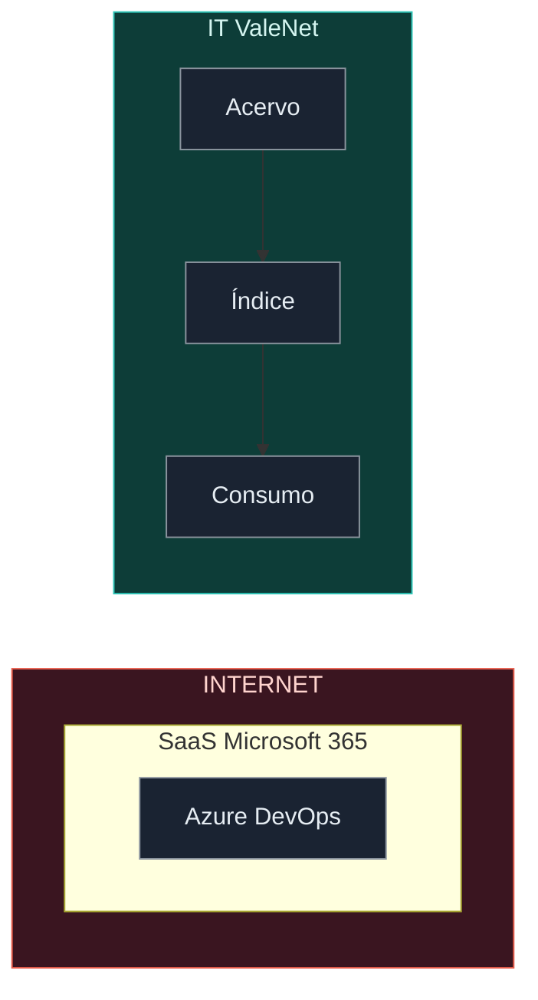

# 02 — Arquitetura

## Diagrama interativo (Archify)

Abrir o HTML gerado pela skill **archify** (`dataflow` + `meta.animation: "trace"`):

- [pipeline.html](diagrams/archify/pipeline.html) — viewer (Light/Dark, Live/Still, Export)
- Fonte JSON: [pipeline.dataflow.json](diagrams/archify/pipeline.dataflow.json)
- PNG do README: [pipeline.png](diagrams/archify/pipeline.png)

> **Não** embutir o HTML no `README.md` — Overview do Azure DevOps só renderiza o PNG.

## Visão por zonas (Mermaid)

Padrão: `flowchart LR` com colunas **INTERNET | IT ValeNet** (fora → dentro).
**SaaS** e **Nuvem Azure** ficam **dentro** de INTERNET (subcaixas), não como zonas irmãs.
Não usar Mermaid C4. Aproximação para doc Git — não substitui HLD LeanIX.

## Componentes

| Componente | Função |
|------------|--------|
| Pastas assets | PNG/SVG (cloud; fonte) |
| Catálogo | metadados (backend; idx) |
| Consumo | design/IA (frontend; uso) |

## Fluxo de dados

1. raw → cat: indexa (local)
2. cat → use: busca (termo)
